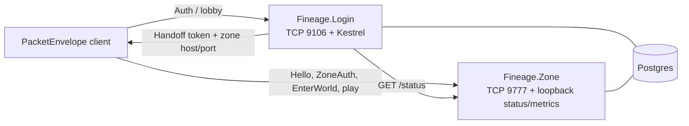
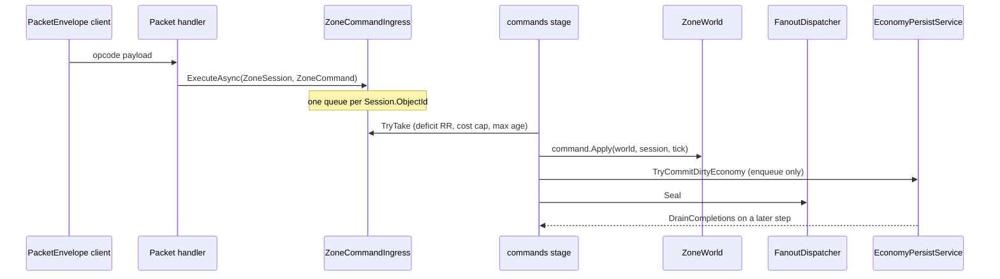
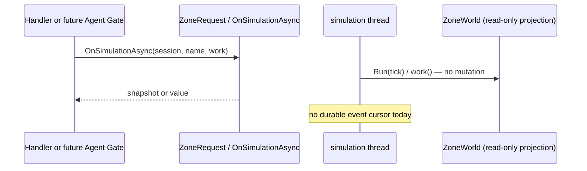
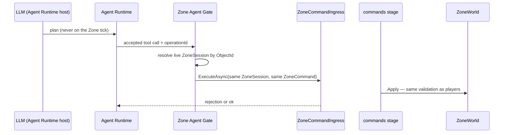

# Agent Runtime reconnaissance (AI-001)

Status: **accepted with ADR 0002–0004** (docs only; no production behaviour change).
Issue: [#998](https://github.com/FioraSolutions/Fineage-Backend/issues/998) under epic [#997](https://github.com/FioraSolutions/Fineage-Backend/issues/997).
Date: 2026-11-28.
Citations are the code on `dev` at the commit that introduced this document.

This is a map of the **real current seams** an Agent Runtime can attach to: command ingress, observation, transport, host topology, and persistence / ledger isolation. It is not a design for a provider, a billing service, an MCP gateway implementation, or squad AI, and it does not create a `Fineage.Agent.*` project (the epic forbids a fictitious project before this card).

Invariants that later cards must keep:

- No LLM, no provider HTTP, and no `await` of Agent Runtime (or any other external I/O) on the Zone simulation tick.
- Agent commands enter the **same** ingress and validation as player commands. There is no second game API and no forged TCP client.
- AI billing and credits are financially isolated from the **auditable economy ledger**. They must not share `ILedgerJournal`, `IAccountStore.CommitEconomy`, or character currency / item bags.
- The AI layer can be left unstarted; ordinary play continues.

Related: [`zone-simulation.md`](zone-simulation.md), [`economy-persistence-pipeline.md`](economy-persistence-pipeline.md), [ADR 0001](../adr/0001-custom-net-wire.md) (player wire), [ADR 0002](../adr/0002-agent-runtime-host.md) (host topology), [ADR 0003](../adr/0003-agent-zone-transport.md) (transport), [ADR 0004](../adr/0004-mcp-gateway-topology.md) (MCP gateway).

---

## 1. Current host topology

There is no generic host and no DI container. Zone's composition root is the top-level script `src/Fineage.Zone/Program.cs`. Login and Zone are two processes that share Postgres and a short-lived handoff token.

| Process | Client / ops surfaces today | Notes |
|---|---|---|
| `Fineage.Login` | `PacketEnvelope` TCP (port 9106) and Kestrel HTTP (`LoginHttpHost`, `src/Fineage.Login/LoginHttpHost.cs:27–28`) | HTTP is the play-landing auth contract: `GET /api/status` (`:73`), liveness/readiness (`:95–96`), `POST /api/auth/register` and `/api/auth/login` (`:97–99`). Same `LoginService` as TCP login. |
| `Fineage.Zone` | `PacketEnvelope` TCP (port 9777) is **the only client transport** (`Program.cs:36`, listen at `:250–253` via `NetTcpServer` → `NetZoneServer.HandleAsync`) | No Kestrel. Loopback-only ops HTTP: `FineageMetricsHost.Start` (`Program.cs:156`) and `ZoneStatusHost` (`src/Fineage.Protocol/ZoneStatusHost.cs:8–16`, bound with `TcpListener` on `127.0.0.1` at `:34–45`). `/status`, `/health/live`, `/health/ready`. |
| Cross-process | Login probes Zone through `IZoneStatusSource` (`src/Fineage.Login/ZoneStatusProbe.cs:14–17`); the live implementation is `HttpZoneStatusSource`, which GETs Zone's loopback `/status` (`:36–42`) | Handoff: Login issues a short-lived token; Zone consumes it on `ZoneAuth`. Store is `MemoryHandoffStore` / `IHandoffStore` (`src/Fineage.Accounts/IHandoffStore.cs:13–19`). Secret comes from `FINEAGE_HANDOFF_SECRET` (`Program.cs:216–232`); a default secret is allowed on loopback only. |



There is no in-process Agent Runtime, no Agent listener on Zone, and no MCP surface.

---

## 2. Command ingress (write path into mutable `ZoneWorld`)

This is the only write seam. Packet handlers already use it; Agent Runtime must use it too.

### 2.1 Types and binding

- `ZoneCommand` (`src/Fineage.Zone/World/ZoneCommands.cs:12–32`) is "a player input to the simulation". Handlers submit it with `ZoneWorld.ExecuteAsync`. `Apply` is:

  ```csharp
  internal abstract string? Apply(ZoneWorld world, ZoneSession session, TickContext tick);
  ```

  The apply contract is bound to a `ZoneSession`, not to a bare character or account id. Logged by default (`:19`). Ingress class is `Interactive` / `Gameplay` / `Lifecycle` only (`ZoneCommandClass.cs:3–8`). There is no `CommandSource = AI` today; adding one later is audit metadata, not a second ingress.

- `ZoneSession` (`src/Fineage.Zone/ZoneSession.cs`) is in-world actor + UI state: `ObjectId`, `Account`, `Name`, class/race/sex, `WireSessionId` (`:18`), `InWorld` (`:21`), position, trainer/chat/locale, enter-prepare fields. `Bound => ObjectId != 0` (`:67`). **It is not a TCP handle** — there is no `NetConnection` field. The socket lives beside it.

- The TCP path constructs one `ZoneSession` per connection (`src/Fineage.Zone/Net/NetZoneServer.Handle.cs:13`) and keeps it as a local in `HandleAsync`. After `ZoneAuth`, `NetPresenceHub.Register(zoneSession.ObjectId, conn, self)` (`:43–50`) maps **object id → connection**, not session. There is no world-level `ObjectId → ZoneSession` directory today. That gap is a change point for AI-005 (see §7), including a future headless (no TCP) character.

- `ZoneWorld.ExecuteAsync` (`src/Fineage.Zone/World/ZoneWorldCommands.cs:37–38`) is a one-line delegate to `_ingress.Submit(session, command, ct)`.

- `ZoneCommandIngress.Submit` (`src/Fineage.Zone/World/ZoneCommandIngress.cs:159`) requires a `ZoneSession`. The `Submission` record holds that session (`:106`). Queues are keyed by `submission.Session.ObjectId` (`:217–221`). One character, one queue. Limits come from `ZoneSimulationSettings`: depth 64, max age 2_000 ms (`ZoneSimulationSettings.cs:95, 101`), plus an apply-cost cap.

### 2.2 When apply runs

`ApplyCommands` is the `commands` world stage (`ZoneWorldSimulation.cs:332` registers it; the body is `ZoneWorldCommands.cs:91–179`). It runs on the simulation thread:

1. `_ingress.BeginApply` / `TryTake` — deficit round-robin over per-player queues, inside the wall-clock apply slice (`:91–110`, `ZoneCommandIngress.cs:268, 324`).
2. `submission.Command.Apply(this, submission.Session, tick)` (`ZoneWorldCommands.cs:123`).
3. Optional command-log append for `Logged` commands (`:141–143`).
4. After the loop, `ReleaseAppliedCommandReplies` (`:158–159`, method at `:200`): drain economy-persist completions, `TryCommitDirtyEconomy` (enqueue, do not wait), `_fanout.Seal`, complete replies. A failed ledger commit does not report success (`EconomyCommitFailed` at `:21`).

`TickContext` (`src/Fineage.Zone/Simulation/TickContext.cs:9`) is `(Tick, NowUnixMs, WallUnixMs)` — one time sample per step.

Between ticks, `AdmitQueuedCommands` (`ZoneWorldCommands.cs:44–69`) may apply a slice of the same ingress, still on the loop thread, pinned to `Tick + 1`.

### 2.3 Affinity

`WorldAffinity` (`src/Fineage.Zone/World/WorldAffinity.cs:25–35`): `MayTouch => !Driven || OnStep`. Off the step, touching the world throws and tells the caller to submit a command or request (`ZoneWorld.ExecuteAsync`). Handlers never take a world turn (`:9–10`).



---

## 3. Observation and snapshot (read path)

There is already a read-projection mechanism through the **same ingress**, not a private world pointer.

- `ZoneRequest<T>` (`src/Fineage.Zone/World/ZoneRequests.cs:10–34`) is not logged and is not replayed (`Logged = false`). `Apply` runs `Run(tick)` and returns null. `OnSimulationAsync` (`:43–58`) and `RequestAsync` (`:73–81`) are the helpers packet code already uses (enter, shortcuts, party match, quest client FX, and others). `ExecuteAroundAsync` (`:66–71`) must not change the world in `around` — replay applies the command alone.

- Enter builds a knownlist and an `EnterSnapshot` on the simulation thread (`ZoneWorld.More.Enter.cs:54`, knownlist still owned by the sim at `:423`). Net encodes that snapshot (`EnterEncoder.cs:9–12`). Later AOI diffs are `NetKnownlistFanout` (`src/Fineage.Zone/Net/NetKnownlistFanout.cs:9, 40`).

- Events: `OutboxingWorldEventPublisher` (`src/Fineage.Zone/World/OutboxingWorldEventPublisher.cs:13`) → `WorldFanoutSequencer` (`WorldFanoutSequencer.cs:10`) → `FanoutDispatcher` (`FanoutDispatcher.cs:31`, dedicated worker) → `NetPresenceHub` (`src/Fineage.Zone/Net/NetPresenceHub.cs:13`). The outbox is per-step and in memory. **There is no durable event cursor** for a late subscriber. A versioned snapshot + cursor is a later card (epic AI-007), not a Zone-tick journal invented here.

Agent observation must project through `OnSimulationAsync` / `ZoneRequest<T>` (or a thin wrapper over them) into an agent-facing snapshot. It must not hold a mutable `ZoneWorld` or `ZoneEntity`, and it must not share a player's `OutboundMailbox` by pretending to be a TCP client.



---

## 4. I/O-forbidden zone (the tick)

Nothing in the following may call an LLM, a provider, Agent Runtime, or any other blocking external I/O:

- The `commands` stage, including `Apply` and `ReleaseAppliedCommandReplies` (`ZoneWorldCommands.cs:91–179, 200+`).
- Every other `RegionTickScheduler` stage on the step that owns the world (`WorldAffinity`).
- `ILedgerJournal.Append` (`src/Fineage.Game/Economy/LedgerJournal.cs:9–17`): "must not block on I/O"; durable write is `Flush` / `CommitWith`, called off the apply body via `EconomyPersistService`.
- `SimulationSyncIoGuard` (`src/Fineage.Zone/World/SimulationSyncIoGuard.cs:8–12`) already records on-step account-store and ledger calls as `sync_io.*`. New work must not add such calls; it must not add Agent I/O either.

Work that is already off the step and must stay off it:

- `EconomyPersistService` (`src/Fineage.Zone/World/EconomyPersistWorker.cs:19–23`): simulation only `TryEnqueue`; `DrainCompletions` is drained on the sim thread after the worker finishes. The worker calls `IAccountStore.CommitEconomy` (`:431`).
- `CharacterPersistWorker` (`src/Fineage.Zone/World/CharacterPersistWorker.cs:7–10, 22`): non-economic snapshots only. Currency, items, warehouse, freight, and the economy ledger do not use this worker.
- `FanoutDispatcher` encode/send.
- Packet-handler `await ExecuteAsync(...)` (the handler thread waits for admission and fan-out, not the tick).

---

## 5. Persistence and the auditable economy ledger

Game-economy durability is a single transactional path:

- `ILedgerJournal` is the append-only store of committed transactions (`LedgerJournal.cs:9–17`).
- `IAccountStore.CommitEconomy` (`src/Fineage.Accounts/IAccountStore.cs:82–86`) inserts journal entries and applies every dirty bag (and optional world-state documents) in **one** transaction. A failure leaves the ledger and every bag as they were.
- Zone enqueues that commit through `EconomyPersistService`; it does not flush bags inside `Apply`.

**AI billing and credits are not part of this path.** They must not append to `ILedgerJournal`, must not be passed to `CommitEconomy`, and must not move character currency or items as a way of paying for inference. A later billing card introduces a separate store, owned by the Agent Runtime host (ADR 0002). Charge is per accepted Agent operation, never per Zone tick.

Character snapshots (`CharacterPersistWorker`) are also the wrong place for AI credits: that worker is the character/pet document path, not a billing ledger.

---

## 6. Command-seam decision

`Apply` and `Submit` require a `ZoneSession`. An Agent must not spoof a TCP client, and must not use the load-test bot path (§8). Two options were evaluated. This section is the decision; it is not a fourth ADR.

### Option A — Change the apply contract to a `Subject` / `ActorRef`

Replace `Apply(ZoneWorld, ZoneSession, TickContext)` (and `Submit`) with a narrower subject: character id plus the fields commands actually read, detached from session UI state.

- *For:* a clean type that is not named "session"; headless agents do not look like a leftover TCP object.
- *Against:* every command and many world helpers take `ZoneSession` today (identity, locale, trainer, chat clocks, enter-prepare, `InWorld`). The type is already not a socket, so a repo-wide signature change does not unlock a new capability for the first vertical slice. It is a large mechanical refactor that belongs in a later card if TCP-only fields become a real problem.

### Option B — Submit against the live in-world `ZoneSession` without a TCP client (chosen)

Keep `ExecuteAsync(ZoneSession, ZoneCommand)` as the only write API. Agent Runtime never opens a `PacketEnvelope` connection. A Zone-side Agent Gate (ADR 0003) resolves the **existing** in-world `ZoneSession` by character `ObjectId` and calls `Submit` / `ExecuteAsync` / `OnSimulationAsync` on that object.

- *For:* one game API, one queue per `ObjectId` (`ZoneCommandIngress.cs:217–221`), the same `Apply` and validation as players, the same cost cap, depth limit, and max age. `ZoneSession` already has no connection field; the TCP socket is a sibling registered in `NetPresenceHub`. A human and an Agent acting on the same character naturally share one queue if they share one session.
- *Against:* there is no `ObjectId → ZoneSession` directory today (the session is a local in `HandleAsync`). That directory must be added when AI-005 lands, and a headless enter path must put a `ZoneSession` into it without a `NetConnection`. Fan-out to the player's client stays on `NetPresenceHub`; Agent observation is a separate projection (§3), not a second mailbox on the same connection.

**Choice: option B for v1.** Do not fork a second command hierarchy. Do not add `CommandSource = AI` as a way around ingress. A later, optional extraction of `CommandSubject` from `ZoneSession` can be justified if connection-scoped fields leak into Agent apply; it is not required to start.

Rules the Gate must keep:

- Resolve the live session; do not construct a throwaway `ZoneSession` with a forged `ObjectId`.
- One in-world subject per character. If a player is also connected, the Agent uses that same instance.
- Rejection strings from `Apply` / ingress close (queue depth, max age, persist failure) are the Agent-visible outcome; the Agent Runtime records `operationId` and the audit trail (AI-006).



---

## 7. Change points for AI-002 … AI-006

No `Fineage.Agent.*` project is created in this card. Later cards may introduce one; until then, contracts live as documents and the Zone-side seam is a thin adapter next to existing types.

| Card | What it is | Concrete change point, or why the card is not needed |
|---|---|---|
| **AI-002** Agent Contracts v1 | One authoritative Agent API (tools, snapshots, errors, `operationId`). MCP and native function calling describe the same tools. | New contract types, owned by the Agent Runtime host, not by `Fineage.Net.Contract` (that assembly is the player `PacketEnvelope` wire; ADR 0001). Do not duplicate `ZoneCommand` in a second game API: the contract *names* tools; the Gate *maps* an accepted tool call onto an existing `ZoneCommand` or `ZoneRequest<T>`. |
| **AI-003** Identity and binding | Tenant, principal, agent, character (and later session) as distinct ids; bind/unbind; audit. | No such types exist in Zone today. The Zone-facing binding result is the in-world `ZoneSession` (`ObjectId`, `Account`). Auth of the Agent itself is not `ZoneAuth` and not a player handoff token. Implementation lives in the Agent Runtime host plus a Zone-side bind record the Gate can resolve. |
| **AI-004** Observation and tools | Read tools: look, inspect, inventory, and similar projections. | Extend `OnSimulationAsync` / `ZoneRequest<T>` (`ZoneRequests.cs:10–34, 43–58`) with agent-facing projections. Reuse knownlist / enter snapshot *data*, not `EnterEncoder` frames and not `NetKnownlistFanout` mailboxes. No mutable `ZoneWorld` handle leaves the process. No durable cursor here (that is epic AI-007). |
| **AI-005** Command path and validation | Write tools through normal Zone validation, same rate/queue limits, `operationId`. | The Agent Gate called for in ADR 0003: `ObjectId → ZoneSession` directory (populated at enter / headless bind, cleared at leave), then `ExecuteAsync` (`ZoneWorldCommands.cs:37–38`). Optional `CommandSource` on the submission / command log is audit metadata. Tests to extend: `tests/Fineage.Zone.Tests/ZoneCommandIngressTests.cs`, `ZoneCommandSchedulerTests.cs`, and economy reply tests (`EconomyAckAfterDurableTests.cs`, `EconomyReplyCarryTests.cs`) so Agent-submitted commands get the same commit-before-success behaviour. |
| **AI-006** Operation registry and idempotency | Registry of running / completed operations; retry must not double-apply. | Lives in the **Agent Runtime host**, not in the Zone tick. Zone already returns a rejection or null from `ExecuteAsync` after apply + fan-out. The registry records that outcome against `operationId`. Do not add a second command log in Zone for this. |

---

## 8. Load-test bots are not the Agent path

`tools/Fineage.LoadTest` (`FineageBotClient`, `ConnectAndEnterAsync` at `FineageBotClient.cs:95`, writes `PacketEnvelope` to Login and Zone at `:713, 748`) is a **real TCP client**. It is a legitimate load tool. It is not a template for Agent Runtime, not a way to "just log in as the character", and not an allowed bypass of the Agent Gate.

---

## 9. Tests that later cards should extend

Do not invent a new test project for the first seams. Extend:

- `tests/Fineage.Zone.Tests/ZoneCommandIngressTests.cs` — queue depth, max age, per-`ObjectId` fairness.
- `tests/Fineage.Zone.Tests/ZoneCommandSchedulerTests.cs` — admission and apply timing.
- `tests/Fineage.Zone.Tests/EconomyAckAfterDurableTests.cs`, `EconomyReplyCarryTests.cs` — success is not reported when the auditable economy commit fails.
- Existing `ZoneRequest` / enter tests, when AI-004 adds projections.

Load-test scripts stay a player-traffic harness.
