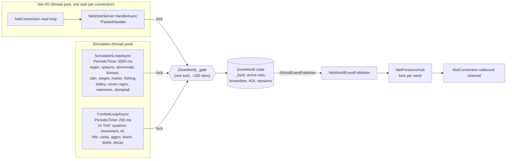
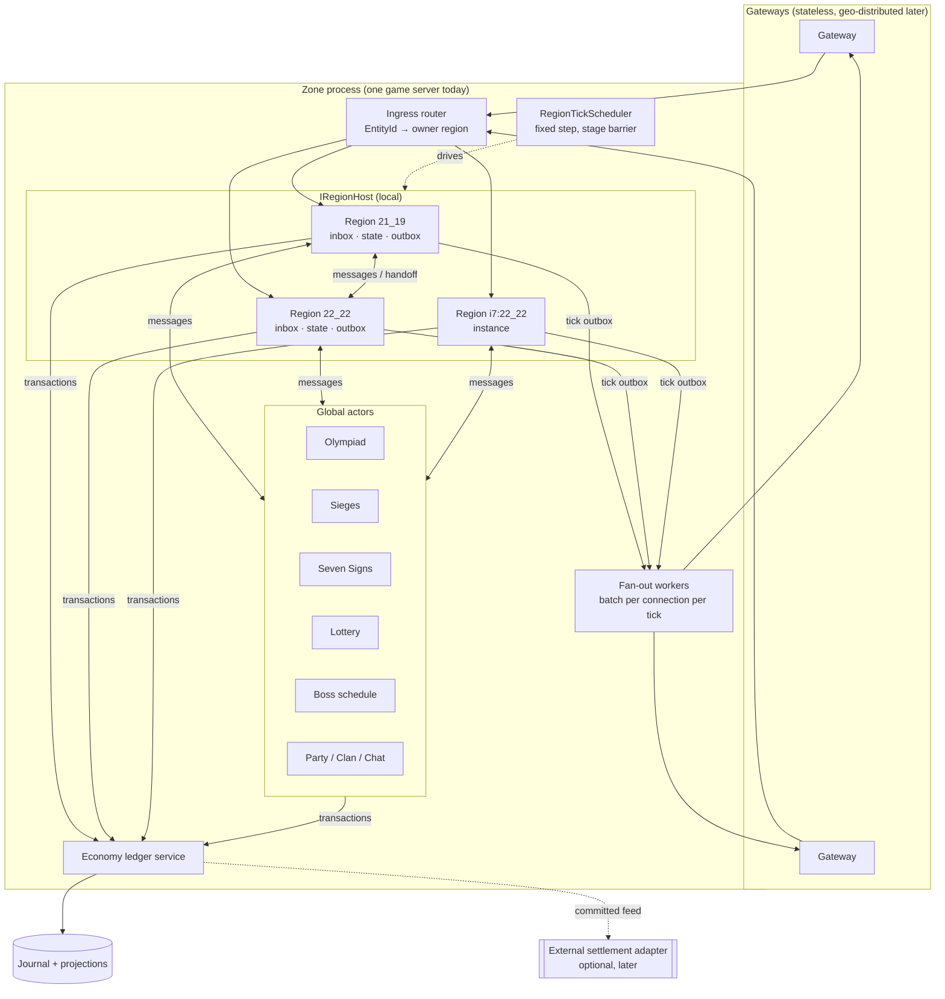
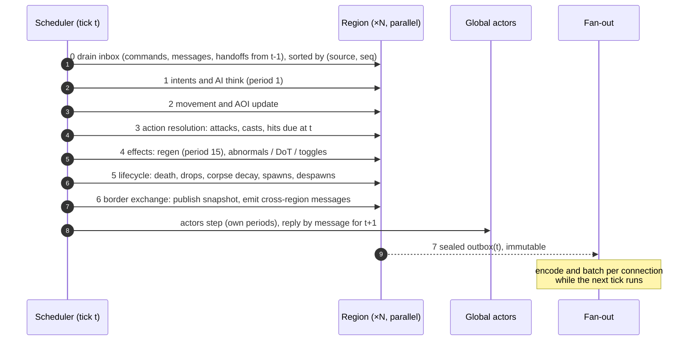
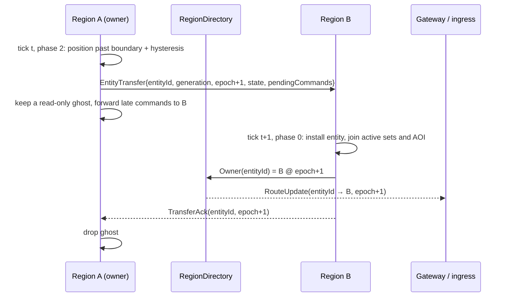
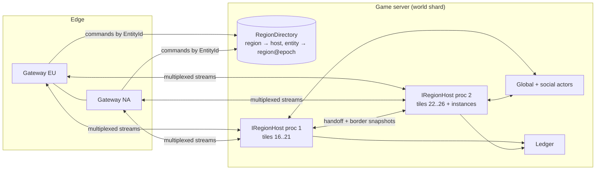
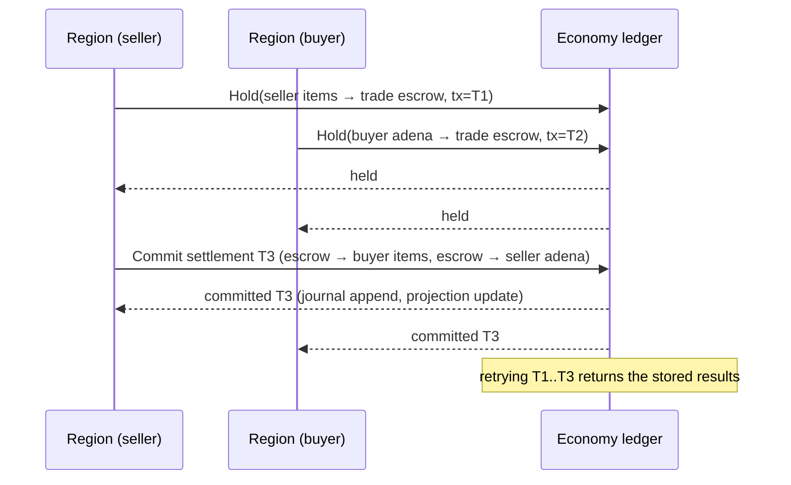

# Zone simulation architecture

Status: **steps 1–5 implemented** (region tick scheduler with regen and abnormals per region, the combat loop on the
same scheduler, the reverse watcher index, the per-step fan-out outbox, and tick-derived time with seeded per-region
random streams, a command log and replay); steps 6 and later are proposals.
Scope: the tick part of `Fineage.Zone` (simulation loops, NPC AI, combat resolution, regen, abnormals, presence
fan-out) and the boundaries it needs: scale-out seams and the economy ledger. Quests, NPC HTML and catalogs are out
of scope. Mobius CT0 Interlude is the behavioural reference only (GPLv3): rules are re-derived, never copied.

Related: [`docs/ZONE_MODULARIZATION.md`](../ZONE_MODULARIZATION.md) (row "Simulation actor / retire global `_gate`").

---

## 1. Summary

| | Today | Target |
|---|---|---|
| Ownership | One `ZoneWorld` owns every entity in one `Dictionary<int, ZoneEntity>` | Regions (map tile per instance, splittable) own their entities |
| Concurrency | One `lock (_gate)` serialises two loops and every packet handler | Regions tick in parallel; one thread per region per step, no locks on hot paths |
| Clock | Two `PeriodicTimer`s (3 s and 200 ms), wall clock read per subsystem | One fixed-step clock; stages declare a period in ticks; one time sample per step |
| Cross-entity effects | Direct mutation of any entity under the lock | Direct inside a region; messages between regions; handoff when crossing borders |
| Global systems | `Tick*` calls inside the 3 s loop | Single-threaded actors with mailboxes |
| Fan-out | Per event: scan all players, encode, `TrySend` per watcher | Per region per tick: outbox, coalesce, encode once, batch per connection |
| Economy | Inventories persisted as whole-bag snapshots | One append-only, double-entry, idempotent ledger service; inventories become projections |
| Scale-out | One process, one world | Same region abstraction behind `IRegionHost`; gateways route by entity owner |

---

## 2. Current state

### 2.1 What runs where

There are not many independent timers: the world has **two** loops, both started by `ZoneWorld.StartSimulation`
(`src/Fineage.Zone/World/ZoneWorldRegen.cs`), and both take the same global lock.



### 2.2 Concrete bottlenecks

| # | Bottleneck | Where | Effect |
|---|---|---|---|
| B1 | One lock for the whole world | `ZoneWorld._gate` (`World/ZoneWorld.cs:98`), ~200 `lock (_gate)` sites in `World/`, entered by every packet handler through `ZoneWorld` methods | The zone runs on one core at a time. A 200 ms combat tick, a 3 s sim tick and every packet handler queue behind each other; handler latency grows with tick cost. |
| B2 | Audience by full player scan | `Players()` (`World/ZoneWorld.Members.Views.cs:50`) allocates a list by scanning every entity; 48 `foreach … in Players()` call sites, e.g. `FanoutVitals` (`World/ZoneWorldRegen.Members.cs:82`), `FanoutAbnormal` (`World/ZoneWorldAbnormals.Tick.cs:158`), `ActorAudience` (`World/ZoneWorldCombat.Members.cs:257`), `ReleaseThink` (`World/ZoneWorldActiveSets.cs:125`) | Every vitals/abnormal/attack fan-out costs O(players), so a tick costs O(subjects × players). 2 000 wounded entities × 3 000 players is 6 M knownlist probes per regen tick, all under B1. |
| B3 | Per-tick list copies of the population | `TickAutoAttacks` copies `Players().ToList()` every 200 ms (`World/ZoneWorldCombat.Members.cs:124`); regen/abnormal ticks `ToArray()` the active sets | Steady allocation at 5 Hz feeds GC pauses, which stall the lock holder. |
| B4 | Simulation loop died silently on any exception | `SimulationLoopAsync` had no catch; the task was never observed | One throw in any of 13 systems stopped regen, spawns, sieges and olympiad for the rest of the process. **Fixed in step 1** (per-stage isolation, logged with stage/region/tick). |
| B5 | Missed ticks were invisible | `PeriodicTimer` coalesces missed periods | Overload showed up as slower regen, not as a signal. **Fixed in step 1** (`fineage.tick.overruns`, warning naming the slowest stages). |
| B6 | Wall clock read per subsystem, hash-order iteration | `_clock()` called once per `Tick*`; `HashSet`/`Dictionary` iteration order in ticks | The same inputs do not reproduce the same run, so there is no replay testing. **Step 1** samples time once per step and orders region work deterministically for the migrated stages. **Step 5** derives stage time from the tick and logs commands for replay (section 4). |
| B7 | Shared, unseeded randomness | `Random.Shared` defaults for combat, spawn, drop, death, service (`World/ZoneWorld.cs:203-262`) | Not reproducible; one shared stream cannot be split across parallel regions. **Step 5** replaces them with seeded streams per (purpose, region) (section 3.2). |
| B8 | Fan-out is per event and per watcher | `NetWorldEventPublisher.FanoutStatusUpdate` encodes, then `NetPresenceHub.TrySend` takes the hub lock per watcher (`Net/NetPresenceHub.cs:51,80`) | N small frames per tick per watcher, lock traffic proportional to watchers × events, no coalescing of superseded StatusUpdates. |
| B9 | Knownlist diff fan-out awaits inside the request path | `NetKnownlistFanout.FanDiffAsync` awaits `SendAsync` per spawn/despawn (`Net/NetKnownlistFanout.cs`) | A slow client slows its own handler; spawn bursts (teleport into Giran) are serial. |
| B10 | Economy persisted as snapshots | `ZoneCharacterPersist.ReplaceItems` / `ReplaceWarehouse` (`World/ZoneCharacterPersist.cs:59-63`), deferred by `WithDeferredInventoryPersist` (`World/ZoneWorld.Members.Persist.cs:129`); trade writes two bags (`World/ZoneWorldTrade.More.cs:106`) | No record of *why* an item moved, no idempotency, and a crash between the two bag writes duplicates or loses items. Nothing to audit or reconcile against. |
| B11 | Session intent state mutated from two sides | `ZoneSession` (`AutoAttackTargetId`, approach, pending cast/pickup/talk) written by handlers and by the combat tick | Correct only because of B1; blocks any move off the lock. |

L2J has the same shape plus per-object scheduled tasks; Fineage already replaced those with active sets
(`World/ZoneWorldActiveSets.cs`), which is the right base for regions: only entities with work are visited.

---

## 3. Target design

### 3.1 Overview



### 3.2 Regions

- **Identity.** `RegionId(InstanceId, X, Y)` (`src/Fineage.Zone/Simulation/RegionId.cs`). The default partition
  is the Interlude map tile, 32 768 units with geodata offsets, so a region id reads like its geodata file
  (Giran `22_22`). Instances (dungeons, olympiad arenas) are separate regions on the same tile. The partition is
  pluggable (`IRegionPartition`), so hot tiles (Giran, a castle during siege) can later be split into quadrants
  without touching systems.
- **Ownership.** A region owns the entities whose position lies in it: the entity record, its active-set
  memberships (`moving`, `thinking`, `aiBusy`, `pendingHit`, `decaying`, `needRegen`, `withAbnormals`), its
  knownlist and a region-local AOI index (the current `GridAoi` cell of 3 000 units fits a 32 768 tile 11×11).
  Player session intent (B11) moves into the player entity and is written only by the owning region, from commands.
- **Interest radius ≤ region size.** Visibility and AoE never reach beyond the 8 neighbours, which bounds every
  cross-region interaction to neighbour messages and border snapshots.
- **Region-local RNG.** Each region draws from its own stream per purpose (`RandomPurpose`: combat, spawn, drop,
  death, service, quest, soul crystal), seeded by `(worldSeed, purpose, RegionId)` and advanced only by draws made
  for that region (`SeededRegionRandom`, `Simulation/RegionRandom.cs`). A rule draws from the region of the entity
  that acts: the attacker for hits and skill effects, the target for a debuff landing on it, the corpse for drops,
  the killer for quest rolls. Purposes keep one system's new draw from shifting another's sequence. Global systems
  (fishing, manor, lottery, mammon) draw from one seeded stream each. The generator is xoshiro256** owned in
  `Simulation/SimulationRandom.cs`, so a seed rolls the same values on every runtime version. The world seed comes
  from `FINEAGE_ZONE_SEED` (fresh when unset, logged at startup).

### 3.3 Tick pipeline

One fixed step (target 200 ms, the current combat cadence). Every stage declares a period in ticks; today's 3 s
systems become period 15. Within a step, stages run in a fixed order with a barrier between them; within a region
stage, regions run in parallel, each single-threaded.



### 3.4 Threading model

- **Simulation workers.** A fixed pool, one per core minus I/O headroom, runs region bodies through
  `IRegionExecutor` (`ParallelRegionExecutor` today wraps `Parallel.For` with a bounded degree). The scheduler
  thread runs collect steps and world stages and waits at each stage barrier.
- **Inside a region:** one thread at a time, plain collections, no locks. A region body may read and write only
  its own state, read the previous tick's neighbour snapshots, and append to its own outbox or outgoing mailboxes.
- **Between regions:** multi-producer single-consumer mailboxes. Messages posted during tick *t* are consumed in
  phase 0 of *t+1*, ordered by `(sourceRegion, sequence)`, so arrival order between threads cannot change results.
- **I/O threads never touch simulation state.** Handlers decode, validate shape, and enqueue a command for the
  owning region. Reads that need world state (enter-world projection) become request messages answered at the next
  tick.
- **Global actors** run on the scheduler thread as world stages (cheap) or on their own single-threaded loop when
  they do I/O; they talk to regions only by message.
- **Persistence and the ledger** run outside the tick. Regions hand them immutable records and get results back
  as messages.

### 3.5 Cross-region interactions

**Entity crossing a border (handoff).** The owner detects the crossing after movement, with hysteresis (a few
hundred units past the boundary) so pacing along an edge does not ping-pong.



Rules: the epoch rises on every transfer; commands and messages carry the epoch they were routed with; a region
that no longer owns the entity forwards to the directory's owner instead of dropping it, and logs a misroute when
the epoch is older than the current one by more than one. Transfer state is the serialized entity, its abnormals with
absolute expiry ticks, and in-flight intents (pending cast or hit).

**Visibility and AoE near borders.** At the end of each tick a region publishes a border snapshot: the entities
within the interest radius of each edge, as immutable presence records. Neighbours read the previous tick's
snapshot (one tick of latency, deterministic) for knownlist, targeting and AoE candidate selection. Effects on a
foreign entity are never applied directly; they become a `DamageRequest` / `ApplyAbnormal` message carrying the
attacker snapshot needed by the formula, resolved by the owner at *t+1*. One extra tick (200 ms) is inside L2's
existing hit delay.

**Party, clan, chat, friends.** Social actors keyed by party / clan id. Regions push member deltas (vitals,
position) to them once per tick in a batch; the actors fan out to members through gateway routing, independent of
which region or process a member is in. Chat channels with a range (say, shout) resolve the audience from region
AOI; global channels (trade, hero, clan) go through the social actor.

**Global systems** (olympiad, sieges, seven signs, lottery, boss schedule, manor, mammon, clan hall auctions) become
actors with their own state and mailbox. They act on the world through messages
(`SpawnNpc(region, template, at)`, `Teleport(entity, to)`, `SetZoneFlag(area, flag)`) and receive events
(`BossKilled`, `PlayerEnteredArena`).

### 3.6 Network fan-out

- During the tick, systems append presence events to the region outbox: subject, kind and payload inputs, not
  encoded bytes.
- After the tick the sealed outbox goes to fan-out workers. Audiences come from the region AOI index (a reverse
  knownlist "who watches X" maintained with knownlist changes), replacing B2's scans.
- **Coalescing per tick:** last write wins per `(kind, subject, audience)` for replaceable state (StatusUpdate,
  MoveState, ChangeMoveType, AbnormalStatusUpdate). StatusUpdate carries a subset of attributes, so a superseded
  write's other attributes are merged into the latest. The surviving write takes the position of the last one;
  ordered must-deliver events (Attack, MagicSkillUse, Die, spawn and despawn) keep emission order around it.
- **Sealed and gate-ordered (step 4):** a step records into a batch under `_gate` and seals it before unlocking.
  Payload inputs are captured then: watcher lists are copied, and the two calls whose encoding reads world state
  (knownlist diff, CharInfo) are built by `IWorldEventPublisher.Prepare*`. One send lock drains sealed batches
  before any send made outside a step, so handler traffic never overtakes an earlier step. Sends never take
  `_gate`. A failed send is logged with its exception, counted as `fineage.tick.stage.failures{stage="fanout"}`, and
  the rest of the batch still goes out.
- **Encode once per event, batch per connection:** one frame group per connection per tick, written with one
  channel write. That replaces the per-frame `NetPresenceHub` lock (B8); the hub's id→connection map becomes a
  per-tick read-only snapshot.
- The simulation never awaits a socket. `NetConnection` keeps its bounded outbound queue and drop counters, and
  coalesced MoveState already exists there.

### 3.7 Scale-out seams (defined now, built later)



| Seam | Contract | In-process now | Distributed later |
|---|---|---|---|
| `IRegionHost` | `Step(tick)`, `Post(RegionMessage)`, `Accept(EntityTransfer)`, `SealOutbox(tick)` | Regions on `RegionTickScheduler` | One host per process; ticks aligned by a tick broadcast from a coordinator |
| `IRegionDirectory` | `OwnerOf(RegionId)`, `OwnerOf(EntityId) → (RegionId, epoch)`, change feed | Dictionary | Replicated table with change stream |
| Handoff protocol | `EntityTransfer`, `TransferAck`, `RouteUpdate`, versioned like `Fineage.Net.Contract` | Object passing | Same messages, serialized |
| Gateway ↔ zone | Upstream: `(EntityId, epoch, command)`. Downstream: per-connection frame batches per tick | Current `NetZoneServer` acts as gateway and zone | Gateways terminate client TCP and auth (handoff tokens) and route by directory; zone hosts stream batches back |

Sizing: 12 k concurrent players worldwide is a few world shards of 3–5 k each. A shard starts as one process
using all cores via parallel regions; it splits by tile ranges to more processes only when one box saturates. Hot
spots split by partition, not by special cases.

### 3.8 Economy ledger

Every movement of currency or items between owners goes through one service, the **economy ledger**: append-only,
double-entry, idempotent, auditable. Inventories, warehouses and stores become projections of the ledger.

**Model**

- *Account* = `(OwnerKind, OwnerId, Container)`. Owner kinds: character, clan, system. Containers: inventory,
  warehouse, clan warehouse, freight/mail escrow, trade escrow, private-store escrow, ground (world-held drop).
  System accounts are sources and sinks: NPC shop, drop source, quest reward, tax, fees, destruction.
- *Asset* = adena or item template; non-stackable items also carry instance ids (enchant level travels with the
  instance).
- *Transaction* = `TxId` (idempotency key), `Kind` (ShopBuy, ShopSell, TradeSettle, Pickup, Drop, WarehouseDeposit,
  WarehouseWithdraw, StoreSale, MailSend, MailClaim, QuestReward, CraftConsume, CraftProduce, Destroy, …),
  postings `(account, asset, ±amount, instanceIds)` that sum to zero per asset, `CausedBy`, `RegionId`, `Tick`,
  wall time. Moves that do not change owner (equip, stack split, reorder) are not transactions.
- `TxId` is deterministic: `(regionId, tick, sequence)` for simulation-originated moves, or `(characterId, client
  request sequence)` for commands, so retries after a timeout or handoff replay to the same id. Tick numbers count
  fixed steps since the Unix epoch (section 4), so they never repeat across restarts and a TxId stays unique.

**Interface (sketch)**

```csharp
public interface IEconomyLedger
{
    // Validates balances and holds, appends atomically, returns the stored result; a repeated TxId returns the
    // original result without a second posting.
    ValueTask<LedgerResult> SubmitAsync(LedgerTransaction tx, CancellationToken ct);

    // Two-phase for moves spanning regions or processes (trade between players in different regions, mail):
    // a hold moves value into escrow, then commit or release settles it.
    ValueTask<LedgerResult> HoldAsync(LedgerHold hold, CancellationToken ct);
    ValueTask<LedgerResult> CommitAsync(HoldId hold, TxId settlement, CancellationToken ct);
    ValueTask<LedgerResult> ReleaseAsync(HoldId hold, CancellationToken ct);
}

public interface ILedgerJournal          // append-only storage (Postgres table with unique TxId, hash-chained segments)
public interface ILedgerProjection       // balances / inventories by account, rebuilt from the journal
public interface ISettlementGateway      // outbound feed of committed transactions by cursor; inbound confirmations
```

**Placement relative to regions.** The ledger is a service outside regions, behind a mailbox. A region keeps a
projected inventory for gameplay checks (weight, slots, "has 1 000 adena") and a pending-hold marker; it submits
the transaction and applies the result when the reply arrives in a later tick's phase 0. A rejection
(insufficient funds, a lost race with another hold) is a normal result shown to the player. It is never silently
corrected.



Audit: every posting names its transaction, kind, cause and tick; item instances can be traced end to end.
Reconciliation compares projections with the journal. The settlement gateway is a narrow, neutral adapter, so an
external settlement backend can consume the committed feed without the simulation knowing it exists.

---

## 4. Determinism

1. **Fixed step.** A step is a tick number: tick `t` is the `t`-th step since the Unix epoch and happens at
   `t × step` (`Simulation/SimulationClock.cs`), so tick numbers mean the same instant on every host and never repeat
   across restarts. Stages run at `TickContext.NowUnixMs`, the tick time; the wall sample travels as
   `TickContext.WallUnixMs` and is used only for calendar schedules (clan dissolution deadlines, hall auctions,
   sieges, manor, lottery, mammon); seven signs and boss respawns keep their own clocks until they become actors
   (step 9). Inside a step the clock is pinned for the scheduler thread, so every rule a stage reaches reads the tick
   time; parallel region bodies use the `TickContext` they are given. The loop sleeps until the next tick is due. A
   late step jumps to the tick the wall clock is in and reports the skipped ticks (a stage whose period was crossed
   runs once); a step while the wall clock is behind still advances one tick. Commands run at their own wall sample,
   pinned for the command, so a deadline they set is honoured on the first tick at or after it.
2. **Ordered iteration.** Region work runs in ascending `RegionId`, entities in ascending object id
   (`RegionWorkCollector.Drain`), never in hash order. Inbound messages are sorted by `(source, sequence)`.
3. **Seeded randomness** per region and purpose (section 3.2), never `Random.Shared` in rules. Outcomes of
   non-random stages do not depend on the partition; stages that draw do, by design, because a different partition
   assigns entities to different streams.
4. **Isolation.** Region bodies touch only region-owned state; cross-region effects are messages consumed next tick.
5. **Verification.** `RegionSimulationDeterminismTests` checks that identical worlds produce identical state *and*
   fan-out sequences, and that outcomes do not depend on the partition (map tiles, 500-unit cells, one cell).
   `RegionTickSchedulerTests` checks that parallel and sequential executors reach identical region-local state.
   Player input goes through `ZoneWorld.ExecuteAsync(session, command)` (`World/ZoneCommands.cs`: move, stop, attack,
   skill use, select and cancel target). When a world records (`SimulationLog`), every step and command is appended in
   gate order with its tick, wall sample, actor and outcome; `ReplayAsync` runs the log on a world built the same way
   (same content, seed and starting tick) and fails at the first entry whose tick or outcome differs.
   `SimulationReplayTests` replays a recorded fight and checks identical state and fan-out; `SimulationRandomTests`
   pins the generator to reference values.

   Not yet covered by seeded streams: boss respawn windows and olympiad matchmaking (global actors, step 9), and
   enchant rolls (`IEnchantRandom`, a handler path until step 6). Handlers that are not commands yet read the wall
   clock unpinned until step 6 routes them through command ingress.

---

## 5. Tick budget and metrics

Targets, to be validated against production metrics before parallelism is enabled:

| Item | Target |
|---|---|
| Step | 200 ms (5 Hz). Regen and other 3 s systems run at period 15. |
| Step wall time (all stages, p99) | ≤ 100 ms, half the step, leaving headroom for GC and bursts |
| Single region body (p99) | ≤ 10 ms; a region that keeps exceeding this gets split by partition |
| Commands | ≤ 1 tick from receipt to effect (p99) |
| Handoff | ≤ 2 ticks to the new owner |
| Fan-out | sealed outbox to socket write ≤ 50 ms (p99) |

Implemented in step 1 (OTEL and `/metrics`):

| Metric | Meaning |
|---|---|
| `fineage.tick.ms` | Whole simulation step including lock wait (existing) |
| `fineage.tick.stage.ms{stage}` | Duration per stage |
| `fineage.tick.stage.regions{stage}` | Regions a stage ran in |
| `fineage.tick.stage.failures{stage}` | Stage or region bodies that threw (also logged with stage, scope, tick and the exception) |
| `fineage.tick.overruns` | Steps longer than the fixed step (also logged with the three slowest stages) |
| `fineage.tick.skipped` | Ticks a late step jumped over (step 5; also logged). Tick time running ahead of the wall clock by a step or more is logged when it starts and ends. |

Planned with later PRs: `region.tick.ms{region}`, `region.entities`, `region.inbox.depth`, handoffs/s and
latency, outbox frames and bytes per tick, fan-out lag, ledger transaction latency and rejections by kind.

---

## 6. Migration plan

Each PR keeps the server playable and the test suite green; behaviour changes are called out per PR.

| PR | Change | Behaviour |
|---|---|---|
| **1 (this)** | `RegionTickScheduler`, `GridRegionPartition`, executors, observer and metrics. The 3 s loop body becomes a scheduler step: regen (players, NPCs) and abnormals/DoT/toggles as region stages, the other systems as world stages in the original order. Sequential executor under `_gate`. | Identical per-entity rules. Intra-tick order is now deterministic (region, id) instead of hash order; a throwing system is logged and isolated instead of killing the loop. |
| 2 | Fold the 200 ms combat loop into the same scheduler: base step 200 ms, sim stages at period 15, one loop, one time sample per step. Its 24 `Tick*` become stages (world stages first). | Same cadences. |
| 3 | Reverse knownlist index ("watchers of X") kept in sync with knownlist changes; replace `Players()` scans in `FanoutVitals`, `FanoutAbnormal`, `ActorAudience`, `ReleaseThink` (B2, B3). | Same audiences, measurably cheaper. |
| 4 | Per-tick outbox: systems emit presence events, flushed after the step outside `_gate` in gate order, coalescing replaceable updates per subject and audience (B8). | Fewer redundant frames; same final client state. |
| **5 (done)** | Tick-derived simulation time and seeded per-region RNG streams in migrated stages; command log and replay test (B6, B7). | Same distributions, reproducible runs. Stage time is quantised to the 200 ms tick, so a deadline set between ticks is honoured on the next tick (it already was by the live loop). |
| 6 | Command ingress: movement, attack and skill-use handlers enqueue commands drained in phase 0 instead of locking (B11); other handlers follow in small batches. | Up to one tick of input latency (≤ 200 ms, already the combat cadence). |
| 7 | Region containers: entities and active sets move into region objects; `RegionDirectory`; in-process handoff at the end-of-tick barrier. | No change visible to clients. |
| 8 | Border snapshots and cross-region messages (damage, abnormal apply, aggro help). Enable `ParallelRegionExecutor` for regen and abnormals behind a setting, then movement and AI after a soak. | Parallel ticks; determinism tests and replay gate each enablement. |
| 9 | Global actors: olympiad, sieges, seven signs, lottery, boss schedule, manor, mammon, clan halls. | Same schedules. |
| 10 | Social actors: party, clan, chat, friends. | Same. |
| 11a–f | Ledger: journal + `IEconomyLedger` in-process, then one movement kind per PR: shop buy/sell, trade, pickup/drop, warehouse, private store, mail, quest rewards, crafting. Each runs alongside the snapshot writes with a reconciliation check until removed. | Same outcomes; every move is now auditable. |
| 12 | Remove `_gate`: the last handlers go through commands or read-only snapshots. | — |
| 13+ | `IRegionHost` over a transport: two processes on one machine, then the gateway split. | Operational only. |

---

## 7. Risks

| Risk | Mitigation |
|---|---|
| Hidden ordering dependencies between systems (one tick reading another's writes) | Stage order is explicit and tested (`Full_step_runs_every_stage_in_the_legacy_loop_order…`); each moved system keeps its slot until proven independent. |
| One tick of extra latency for cross-region effects and commands | Bounded to 200 ms; border snapshots keep visibility smooth; measured per PR. |
| Hot spots (Giran, sieges) concentrate load in one region | Partition by load (split tiles), not by special cases; per-region timing metric drives it. |
| Determinism regressions from new code (hash iteration, `Random.Shared`, wall clock) | Determinism and partition-independence tests per migrated stage; replay test from PR 5; analyzers or review checklist for banned APIs in region code. |
| A replay only reproduces a run built the same way | The log header carries seed, step and start tick and replay refuses a mismatch; content (catalogs, spawns, persisted state) must match too, so replays are a test and diagnostic tool, not a backup. |
| Handoff bugs (lost or duplicated entities, misrouted commands) | Epoch-stamped routing, ghost forwarding, invariant check "every entity has exactly one owner" each tick in debug builds, soak tests walking bots across borders. |
| Ledger becomes a latency bottleneck or a single point of failure | In-memory projection plus batched journal appends; holds keep gameplay responsive; journal on the existing Postgres first, partitioned by world shard later. |
| Migration stalls halfway, with two models living side by side | Every PR is complete on its own and removes the old path it replaces; the plan is ordered so each step pays off without the next. |
