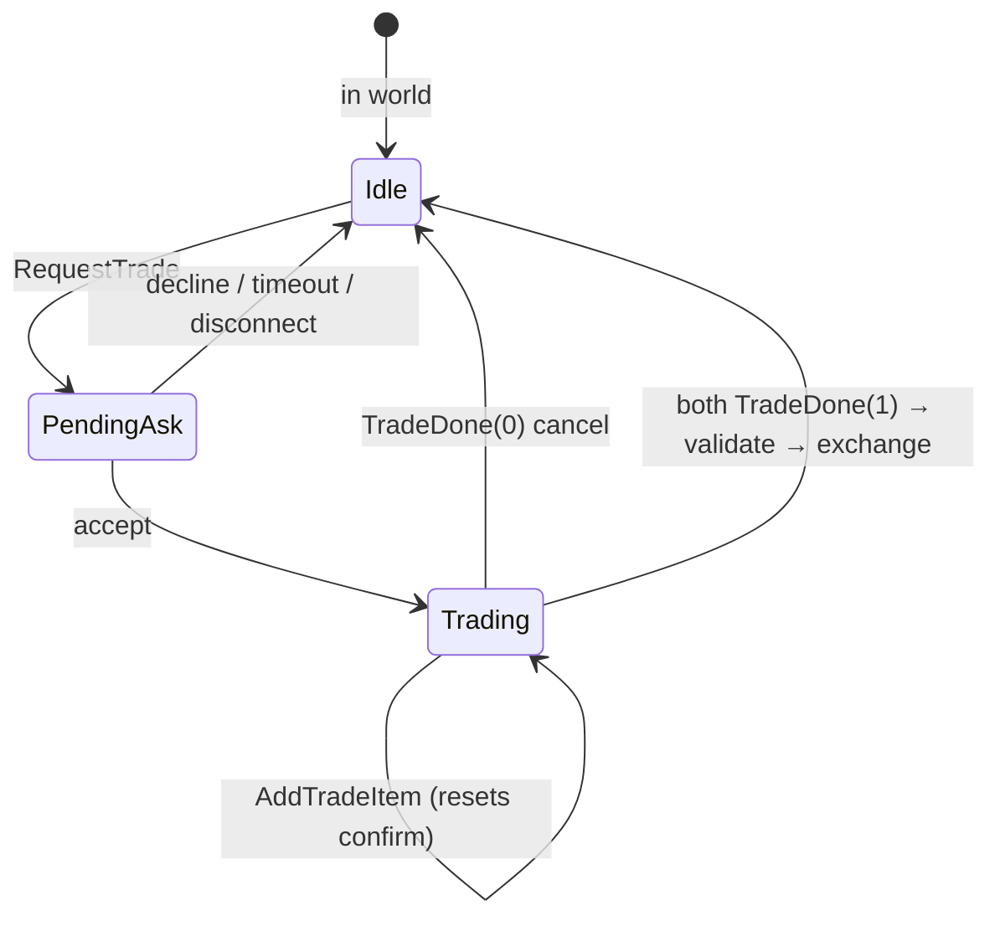

# L2 / L2J Interlude player trade (research → Fineage Zone V2)

Reference: Interlude client/server opcode tables (`packetsInterlude.ini`), L2J Mobius `RequestTrade` / `AnswerTradeRequest` / `TradeListAdd` / `TradeDone`, NetPro packet docs. Fineage **Zone V2** uses MessagePack frames, not binary Interlude bodies.

## Interlude wire (hex opcodes)

### Client → game server

| Opcode | Name | Body (summary) |
|--------|------|------------------|
| `0x15` | **RequestTrade** | `int` target object id |
| `0x40` / `0x44` | **AnswerTradeRequest** | `int` response: **1** accept, **0** decline |
| `0x16` | **AddTradeItem** | `int` trade id, `int` inventory object id, `long` count |
| `0x17` | **TradeDone** | `int` response: **1** confirm, **0** cancel window |

Duplicate **AnswerTradeRequest** names (`0x40` and `0x44`) appear in some packet tables; Interlude clients use one accept/decline packet for the incoming **TradeRequest** prompt.

### Game server → client

| Opcode | Name | Body (summary) |
|--------|------|------------------|
| `0x70` / `0x5E` | **TradeRequest** (SM) | `int` sender object id — prompt target to accept |
| `0x1E` | **TradeStart** | partner object id + partner offer list header |
| `0x1F` | **TradeStartOk** | (empty) — both clients ready |
| `0x20` | **TradeOwnAdd** | item snapshot added to **your** offer column |
| `0x21` | **TradeOtherAdd** | item snapshot added to **partner** column |
| `0x22` | **TradeDone** | `int` result — success / fail / cancel |
| `0x75` | **TradePressOwnOk** | you pressed confirm |
| `0x7C` | **TradePressOtherOk** | partner pressed confirm |
| `0x74` | **TradeUpdate** | full list refresh (variant builds) |

Legacy **GameServerPacketType** names in the Fineage Unity client match these on the **Interlude TCP** path (`SendTradeRequest`, `TradeStart`, `TradeOwnAdd`, …).

## Validation (L2J Mobius Interlude)

Typical checks before and during trade:

| Check | Mobius-style rule |
|-------|-------------------|
| Distance | ~**150** units 3D between traders (`canTradeWith`) |
| Target | Player, visible, not dead, not already trading |
| Busy | No private store, not in olympiad (full L2J) |
| Items | Not equipped; count ≤ bag stack; not quest/no-trade flags (full L2J) |
| Confirm | Each **TradeDone(1)** sets own flag; exchange runs when **both** confirmed |
| Change | Adding an item clears both confirm flags |

**Fineage minimal slice:** distance **150**, visible live players, reject equipped items, max **8** offer rows, no weight / quest-item / store checks yet.

## Server state machine (L2J Interlude)

---

## Mapping → Fineage Zone V2 + client stubs

### What exists on Fineage client (`dev`, Interlude only)

| Legacy incoming | Apply facade (examples) |
|-----------------|-------------------------|
| `SendTradeRequest` | `SendTradeRequestApplyIncomingPacketServices` |
| `TradeStart` | `TradeStartApplyIncomingPacketServices` |
| `TradeOwnAdd` / `TradeOtherAdd` | `TradeOwnAddApplyIncomingPacketServices`, `TradeOtherAddApplyIncomingPacketServices` |
| `TradePressOwnOk` / `TradePressOtherOk` | matching `TradePress*Apply*` |
| `TradeDone` | `TradeDoneApplyIncomingPacketServices` |

Outgoing **RequestTrade** / **AnswerTradeRequest** / **AddTradeItem** / **TradeDone** use the game Interlude socket today. **No Zone V2 trade opcodes** on client yet — dual play needs new `ZoneV2MsgType` + apply bridge (**Fineage #460** after backend **`dev`**).

### Zone V2 MessagePack (backend slice #131)

Use **object id** for targets (same as party). Avoid login **1020–1033** band on S→C.

#### Client → zone (C→S)

| MsgType | Name | MessagePack keys |
|---------|------|------------------|
| **28** | `TradeRequest` | `[0]` targetObjectId |
| **29** | `TradeAnswerRequest` | `[0]` requestorObjectId, `[1]` response (`1` accept, `0` decline) |
| **54** | `TradeAddItemRequest` | `[0]` inventoryObjectId, `[1]` count (default 1) |
| **55** | `TradeDoneRequest` | `[0]` response (`1` confirm, `0` cancel) |

Maps conceptually: `0x15`, `0x40`, `0x16`, `0x17`. **Omitted:** separate trade id (server binds session), **TradeStartOk** as its own opcode.

#### Zone → client (S→C)

On **`main`**, **1073–1076** are Olympiad/death/teleport; trade uses **1077–1082** (see `docs/trade-v2-protocol.md`). **`dev`** uses **1073–1078** for the same message names.

| MsgType (`main`) | Name | MessagePack keys |
|------------------|------|------------------|
| **1077** | `TradeAsk` | `[0]` requestorObjectId, `[1]` requestorName |
| **1078** | `TradeRequestResult` | `[0]` response (`1` accepted, `0` declined) — to requestor |
| **1079** | `TradeStart` | `[0]` partnerObjectId, `[1]` partnerName |
| **1080** | `TradeOfferUpdate` | `[0]` isOwn (`1` self column, `0` partner), `[1]` inventoryObjectId, `[2]` itemId, `[3]` count, `[4]` enchantLevel |
| **1081** | `TradeConfirmState` | `[0]` selfConfirmed, `[1]` partnerConfirmed |
| **1082** | `TradeFinished` | `[0]` response (`1` exchanged, `0` cancelled) |

**TradeOfferUpdate** replaces **TradeOwnAdd** / **TradeOtherAdd** for the minimal server (one shape; `isOwn` selects column). Full **TradeUpdate** refresh can be added later.

#### Client stub mapping (future #460)

| Zone V2 RX | Interlude apply target |
|------------|-------------------------|
| `TradeAsk` (1077 on `main`) | `SendTradeRequest` prompt |
| `TradeStart` (1079) | `TradeStart` window open |
| `TradeOfferUpdate` (1080) | `TradeOwnAdd` or `TradeOtherAdd` by `isOwn` |
| `TradeConfirmState` (1081) | `TradePressOwnOk` / `TradePressOtherOk` synthesis |
| `TradeFinished` (1082) | `TradeDone` close |

| Zone V2 TX | Maps from UI |
|------------|----------------|
| `TradeRequest` | Target action → trade |
| `TradeAnswerRequest` | Accept / decline prompt |
| `TradeAddItemRequest` | Drag item to offer |
| `TradeDoneRequest` | Confirm or cancel |

### Fineage minimal backend behavior (aligned with above)

- One pending trade ask per target; one active trade session per player (shared `ZoneTradeSession` keyed by both object ids).
- **Accept:** `TradeStart` to both; empty offers.
- **Add item:** validate ownership, not equipped, in range; fan-out **TradeOfferUpdate**; reset confirm flags; **TradeConfirmState(0,0)**.
- **Confirm:** **TradeDoneRequest(1)** sets own flag; when both set, validate offers still in bag and execute swap; **InventoryUpdate** + **UserInfo** per player; **TradeFinished(1)**.
- **Cancel / disconnect / out of range on confirm:** **TradeFinished(0)**; clear session.
- **Skip:** weight, private store, hero weapons, pet trade, multi-item list remove, **TradeUpdate** bulk refresh.

---

*Last updated: 2026-10-29 (trade C→S **28/29/54/55**; S→C **1077–1082** on Backend **`main`** #131; **`dev`** S→C band **1073–1078**).*
